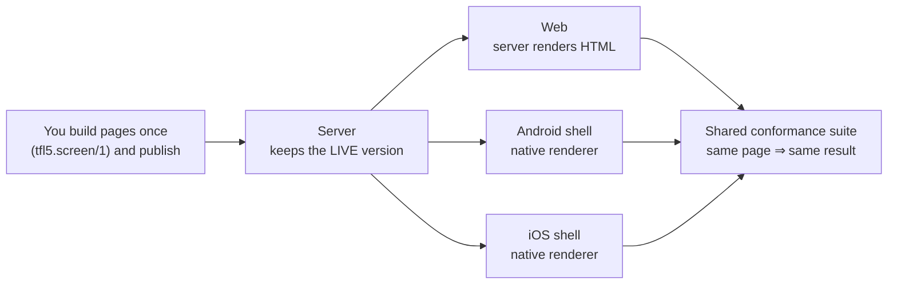
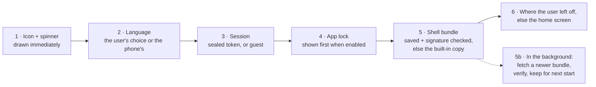
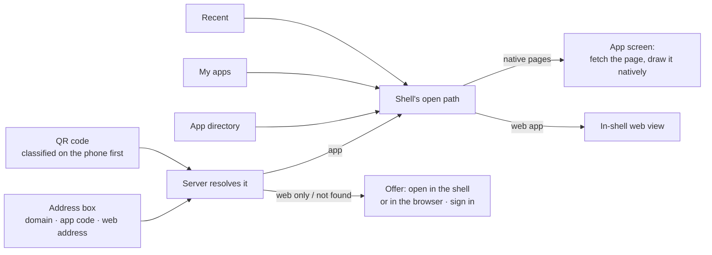

# Mobile — design an app once, the shell draws it everywhere

This is the design standard for apps on phones. It explains the one rule every
mobile decision follows, what the phone app (the **shell**) does when it starts
and when it opens an app, and what does — and does not — need a new release in
an app store.

## 1. The rule

**An app is designed once.** You build its pages once, as page trees in the
`tfl5.screen/1` format, and publish them. The web and the shells for Android and
iOS all draw **the same published tree** with their own native renderer. There
is no per-platform copy of an app, no build step for an app, and nothing to send
to an app store when an app changes.

What keeps the three renderers honest is a **shared conformance suite**: sample
pages, each with the accessibility tree every renderer must produce, plus
negative cases that a correct renderer must reject — proof that the check can
fail. A renderer change that breaks one case does not ship.

## 2. What a change needs

| You change | What it takes | When users see it |
|---|---|---|
| A page, its text, its layout, its data bindings | Publish the app again | The next time the page is opened, on every platform |
| One of the shell's own screens (app directory, settings) | Publish the platform's shell app — a signed bundle | The next time the shell starts |
| A new **kind** of component, a new hardware capability, or a new `schema` version | A new shell release (app store) | After users update the shell |

The shell itself is kept deliberately thin: native renderers for each component
kind, hardware access (camera and QR, NFC, biometrics, microphone),
open and close animations, a web view, and security (sign-in session, app lock,
bundle signature checks). Everything users see as screens is data.

## 3. When the shell starts

1. A light native view (icon and spinner) appears before the UI framework loads,
   so the phone never shows a frozen image.
2. The language chosen in the shell's settings applies to the whole shell; "as
   the phone" follows the phone.
3. The sign-in session is restored from the phone's sealed storage. Without one,
   the user is a guest and can open whatever a stranger may open.
4. If the user turned the app lock on, the lock screen (biometric or code) is the
   first thing drawn and covers everything else. It is native code, never a page.
5. The shell's own screens come from a **signed bundle** (Ed25519). The last saved
   bundle is used if its signature checks out; otherwise the copy built into the
   shell. A newer bundle is fetched in the background and applied at the **next**
   start, never in the middle of a session; the user is told once that the shell
   was updated.
6. The user lands back where they were (the app and page they had open);
   otherwise on the home screen.

## 4. When the user opens an app

- **Ways in:** the address box (a domain, an app code or a web address), a scanned
  QR code, the app directory, "my apps" (signed in), recent apps, or reopening
  the shell where the user left off.
- **QR codes are classified on the phone.** A web sign-in code opens the approval
  screen, a messaging link opens the chat, Wi-Fi or payment codes show their own
  card. Only an address or an app code is sent to the server.
- **Resolving typed text** returns one of three answers: an app, a web-only app
  (the user picks "open in the shell" or "open in the browser"), or not found. "Not
  found" is the same answer whether the app does not exist or is not open to this
  user — the server never says which; a guest is offered to sign in.
- **One open path for every way in.** The shell remembers the app among recent apps
  and opens it according to its kind: an app built from pages opens the native
  app screen; a web app opens in the shell's web view with the app's name in the
  top bar. Opened from a tile or a row, the screen grows out of it.
- **The app screen** fetches the page, draws it with the shared renderer, and shows
  the files icon only to people who build the app. A refusal shows the reason and
  "try again" (and "sign in" to a guest) — never an empty page.
- **Links to the web** inside an app always ask first: open in the shell or in the
  browser.
- **Back** steps back through the app's pages; from the first page it returns to
  where the app was opened, shrinking back into the tile it came from.

## 5. Not built yet

Each app as its own versioned package — downloaded once, with "a new version is
available" shown when the user opens that app — is designed but not built. Today
the shell fetches each page when it is opened: users always get the live version,
but an app cannot be opened without a connection.
